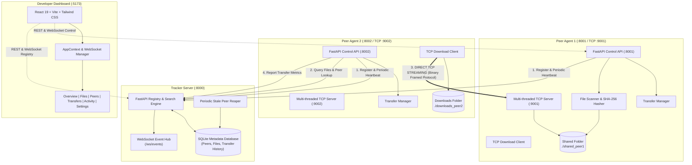
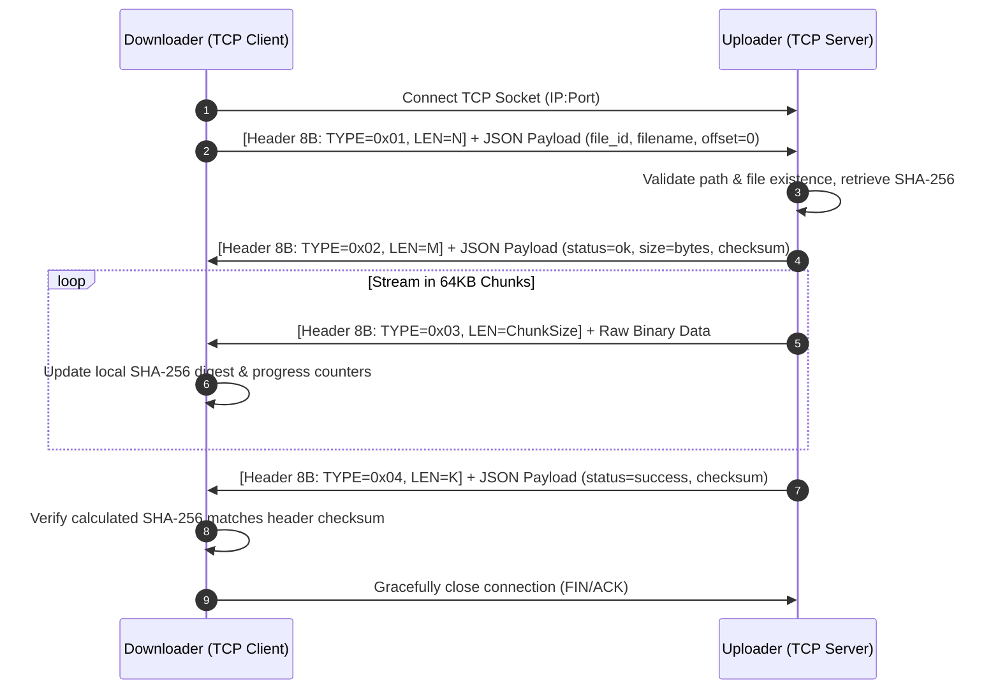

# Peer-to-Peer File Sharing System Using TCP Socket Programming

A complete, high-performance, decentralized peer-to-peer (P2P) file-sharing application built from scratch in Python and TypeScript/React. The system couples a lightweight central tracker for peer discovery and file metadata indexing with custom raw TCP socket file transfers, cryptographic integrity validation (SHA-256), multi-threaded streaming, real-time WebSockets, and a developer-tools dashboard.

---

## 📑 Table of Contents

- [Overview & Architecture](#-overview--architecture)
- [TCP Socket Wire Protocol](#-tcp-socket-wire-protocol)
- [Key Features & Engineering Highlights](#-key-features--engineering-highlights)
- [Technology Stack](#-technology-stack)
- [Project Structure](#-project-structure)
- [API Reference](#-api-reference)
  - [Tracker Server Endpoints](#tracker-server-endpoints)
  - [Peer Control Endpoints](#peer-control-endpoints)
  - [WebSocket Event Stream](#websocket-event-stream)
- [Frontend Dashboard](#-frontend-dashboard)
- [Quick Start](#-quick-start)
  - [Automated Full Stack Launch](#1-automated-full-stack-launch)
  - [Manual Step-by-Step Launch](#2-manual-step-by-step-launch)
- [Automated Testing](#-automated-testing)
- [End-to-End Verification](#-end-to-end-verification)
- [Portfolio & Design Insights](#-portfolio--design-insights)

---

## 🏛 Architecture

The system is organized into three logical tiers:



1. **Tracker Server**:
   - Maintains active peer registrations, hosts, TCP ports, and last-seen timestamps.
   - Manages indexed file metadata (file size, SHA-256 fingerprint, peer associations).
   - Reaps offline peers automatically after heartbeat timeout expiration.
   - **Never touches file payloads** — maintains true zero-relay decentralization.
   - Broadcasts real-time events over WebSockets (`/ws/events`).

2. **Peer Agents**:
   - Each peer is an autonomous process running:
     - A **TCP File Server** listening on raw sockets for binary transfer requests.
     - A **TCP File Client** connecting directly to remote peers for chunked downloads.
     - A **File Indexer** that computes SHA-256 hashes and watches local files.
     - A **Transfer Manager** that tracks progress, speed, and cancels transfers safely.
     - A **Control API** allowing local UI and CLI control with CORS support.

3. **Web Interface**:
   - Modern React 19 + TypeScript + Vite + Tailwind CSS dashboard.
   - Dark developer-tools UI inspired by Wireshark and modern cloud consoles.
   - Configurable peer targeting: seamlessly switch between local peer instances.

---

## ⚡ TCP Socket Wire Protocol

Instead of relying on HTTP file downloads or third-party transfer libraries, this project implements a custom binary framing protocol using Python's standard `socket` library.

### Wire Header (8 Bytes Fixed)

Every message transmitted over TCP begins with an 8-byte fixed-size header packed in network byte order (Big-Endian):

| Offset | Field | Type | Description |
|:---|:---|:---|:---|
| `0..1` | Magic Bytes | `2 Bytes` | Always ASCII `'P'`, `'2'` (`0x50 0x32`) |
| `2` | Protocol Version | `1 Byte` | Current version: `0x01` |
| `3` | Message Type | `1 Byte` | Opcode defining the packet purpose |
| `4..7` | Payload Length | `4 Bytes` (uint32) | Size of the upcoming message payload in bytes |

### Message Types & Opcodes

| Hex | Name | Payload Content | Direction |
|:---|:---|:---|:---|
| `0x01` | `FILE_REQUEST` | JSON: `{"file_id": string, "filename": string, "offset": int}` | Downloader → Uploader |
| `0x02` | `FILE_RESPONSE` | JSON: `{"status": "ok"|"error", "size": int, "checksum": string}` | Uploader → Downloader |
| `0x03` | `CHUNK_DATA` | Binary chunk payload (up to 64 KB per chunk) | Uploader → Downloader |
| `0x04` | `TRANSFER_COMPLETE`| JSON: `{"status": "success", "bytes_sent": int, "checksum": string}` | Uploader → Downloader |
| `0x05` | `TRANSFER_ABORT` | JSON: `{"reason": string}` | Bidirectional |
| `0x06` | `ERROR` | JSON: `{"code": int, "message": string}` | Bidirectional |

### Transfer Flow Sequence



---

## 🛡 Key Features & Engineering Highlights

- **Direct Peer-to-Peer TCP Streaming**: Files are transferred chunk-by-chunk directly between peers without proxying through the tracker.
- **Cryptographic File Verification**: SHA-256 checksums are calculated upon scanning and verified byte-by-byte upon download completion.
- **Path Traversal Protection**: File requests reject null bytes, directory escaping (`../`), absolute paths, and restricted filesystem characters.
- **Thread Concurrency & Non-blocking I/O**: Python `threading` with thread-safe synchronization primitives ensures multiple simultaneous downloads and uploads do not block the node.
- **Resilient Heartbeat & Expiration**: Peers ping the tracker every 15 seconds. If a peer terminates abruptly, the tracker reaps it after 45 seconds of silence.
- **Persistent Metadata**: Tracker persists peers, indexed files, and transfer audit logs in an SQLite database using thread-safe context managers.
- **Live Event Broadcasting**: Real-time push notifications over WebSockets inform connected dashboards of peer events, file discoveries, and transfer progress.
- **Interactive Multi-Peer Frontend**: The web interface allows real-time file searching, peer inspection, manual/automated transfers, live speed gauges, and dynamic switching between local peer nodes.

---

## 🛠 Technology Stack

### Backend
- **Python**: 3.11+ (Tested on Python 3.14)
- **FastAPI**: REST API Framework
- **Uvicorn**: High-performance ASGI Server
- **Socket**: Python Standard Library TCP Sockets
- **Threading**: Native concurrent connection handling
- **SQLite3**: ACID persistent metadata store
- **Pydantic v2**: Strict schema validation & serialization
- **Pytest**: 68 comprehensive unit and integration tests

### Frontend
- **React 19**: Modern UI library
- **TypeScript**: Strict compile-time type safety
- **Vite 6**: Fast next-gen build tool
- **Tailwind CSS v4**: Modern CSS styling
- **React Router v7**: Client-side SPA navigation
- **Lucide Icons**: Clean developer-tool icons
- **Native WebSockets**: Real-time activity telemetry

---

## 📂 Project Structure

```
├── backend/
│   ├── app/
│   │   ├── api/                  # FastAPI REST and WebSocket routes
│   │   │   ├── peer.py           # Peer control endpoints
│   │   │   ├── tracker.py        # Central tracker endpoints
│   │   │   └── websocket.py      # Real-time event broadcaster
│   │   ├── core/                 # Networking and transfer engine
│   │   │   ├── file_index.py     # Local directory scanner & SHA-256 hasher
│   │   │   ├── peer_client.py    # HTTP client for peer-to-tracker requests
│   │   │   ├── tcp_client.py     # Custom TCP socket binary downloader
│   │   │   ├── tcp_protocol.py   # 8-byte binary framing wire protocol
│   │   │   ├── tcp_server.py     # Multi-threaded TCP socket file server
│   │   │   ├── tracker_service.py# Tracker business logic & peer manager
│   │   │   └── transfer_manager.py# Concurrency, status, and rate tracking
│   │   ├── db/
│   │   │   └── database.py       # Thread-safe SQLite repository
│   │   ├── schemas/              # Pydantic v2 data models
│   │   │   ├── file.py
│   │   │   ├── peer.py
│   │   │   └── transfer.py
│   │   ├── utils/                # Security, hashing, and logging
│   │   ├── config.py             # Tracker & Peer settings
│   │   ├── main.py               # Tracker server entry point
│   │   └── peer_main.py          # Peer agent entry point
│   ├── scripts/
│   │   ├── start_tracker.py      # Standalone tracker launcher
│   │   ├── start_peer.py         # Configurable peer launcher
│   │   └── run_demo.sh           # CLI multi-peer demo script
│   ├── tests/                    # 68 automated pytest suites
│   ├── requirements.txt
│   └── tracker.db
│
├── frontend/
│   ├── src/
│   │   ├── app/                  # App shell and React Router
│   │   ├── components/
│   │   │   ├── activity/         # Real-time WebSocket activity feed
│   │   │   ├── dashboard/        # Stats cards, active peers, transfers
│   │   │   ├── files/            # File browser, inspect modal, download
│   │   │   ├── layout/           # Sidebar, TopBar, Toast notifications
│   │   │   ├── peers/            # Peer grid and status indicators
│   │   │   ├── transfers/        # Progress bars, transfer rows, cancellation
│   │   │   └── ui/               # Status badges, skeletons, modals
│   │   ├── context/              # AppContext, WebSockets, notification state
│   │   ├── hooks/                # useApi, useInterval hooks
│   │   ├── services/             # Type-safe API and WebSocket clients
│   │   ├── types/                # TypeScript interface definitions
│   │   └── utils/                # Formatting, byte conversions, constants
│   ├── index.html
│   ├── package.json
│   ├── tsconfig.json
│   └── vite.config.ts
│
├── run_all.sh                    # One-command full-stack launcher
└── README.md                     # Portfolio documentation
```

---

## 📡 API Reference

### Tracker Server Endpoints (`http://localhost:8000`)

| Method | Endpoint | Description |
|:---|:---|:---|
| `GET` | `/api/health` | Service health status and version |
| `GET` | `/api/peers` | List online / offline peers (`?status=online`) |
| `POST` | `/api/peers/register` | Register peer address, TCP port, and shared files |
| `POST` | `/api/peers/heartbeat` | Keep-alive ping preventing timeout expiration |
| `DELETE` | `/api/peers/{peer_id}`| Gracefully unregister peer and remove file index |
| `GET` | `/api/files` | Paginated catalog of all shared files |
| `GET` | `/api/files/search` | Search files by name substring (`?q=term`) |
| `GET` | `/api/files/{id}/peers` | Retrieve online peers hosting a specific file |
| `GET` | `/api/transfers` | Global completed/failed transfer audit history |
| `POST` | `/api/transfers/report` | Peers report completed transfer metrics |
| `GET` | `/api/stats` | Aggregated network statistics |
| `WS` | `/ws/events` | Real-time WebSocket event stream |

### Peer Control Endpoints (`http://localhost:8001` / `:8002`)

| Method | Endpoint | Description |
|:---|:---|:---|
| `GET` | `/api/peer/status` | Current peer configuration, ports, and stats |
| `GET` | `/api/peer/files` | List files in local shared folder |
| `POST` | `/api/peer/share` | Re-scan local directory and publish to tracker |
| `POST` | `/api/peer/refresh` | Trigger instantaneous file indexing |
| `POST` | `/api/peer/download` | Initiate direct TCP download from target peer |
| `GET` | `/api/peer/transfers` | List active, completed, and failed local transfers |
| `GET` | `/api/peer/transfers/{id}` | Real-time progress and speed for a transfer |
| `POST` | `/api/peer/transfers/{id}/cancel` | Abort an ongoing transfer in progress |
| `WS` | `/ws/events` | Local peer WebSocket event notifications |

### WebSocket Event Stream

Clients subscribing to `/ws/events` receive real-time JSON packets:

```json
{
  "type": "file_shared | peer_registered | transfer_started | transfer_completed",
  "timestamp": "2026-10-21T15:10:45.250Z",
  "data": {
    "peer_id": "peer1",
    "filename": "dataset.tar.gz",
    "bytes": 52428800
  }
}
```

---

## 💻 Frontend Dashboard

The frontend dashboard provides a comprehensive developer-tools interface:

1. **Overview**: Live status pills for Tracker & Peer agents, 4 primary telemetry cards (Online Peers, Total Files, Active Transfers, Total Data Transferred), recent transfers list, and active peer directory.
2. **File Explorer**: Search bar, table showing file name, size, truncated SHA-256 hash, and availability status. Includes a "View Peers" modal and a "Download" modal to choose which peer to download from.
3. **Peers Discovery**: Visual grid of all registered network nodes, IP addresses, TCP ports, last-seen relative timestamps, and shared file counts.
4. **Transfers Monitor**: Filterable view (All / Active / Completed / Failed / Cancelled) with animated progress bars, live transfer speeds (`MB/s`), total duration, and transfer abort triggers.
5. **Activity Log**: Real-time event feed powered by WebSockets, with category filtering (Peers, Files, Transfers) and severity color coding.
6. **Settings**: Dynamic Tracker API & Peer Agent URL configuration with one-click connection tests, local peer diagnostic telemetry, and system explanations.

---
