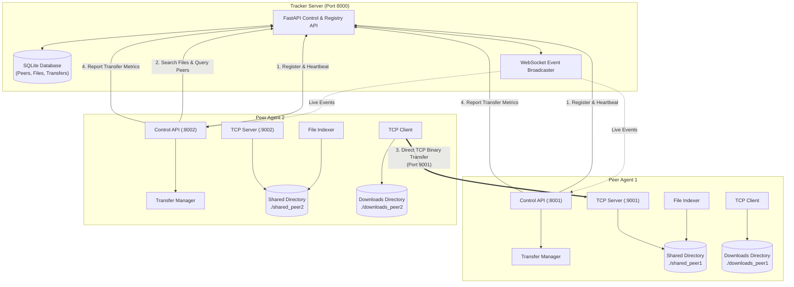

# P2P File Sharing System Using TCP Socket Programming

## Overview
A high-performance peer-to-peer (P2P) file sharing system implemented in Python. The system combines a centralized tracker server for peer coordination and file metadata discovery with direct peer-to-peer TCP socket connections for binary file streaming. Each peer exposes a local REST control API and a persistent TCP file server capable of simultaneous uploads and downloads with cryptographic integrity verification (SHA-256).

---

## Architecture

The system consists of two primary roles:
1. **Tracker Server**: A centralized FastAPI registry backed by SQLite for tracking online peers, indexed file metadata, transfer statistics, and broadcasting real-time system events over WebSockets.
2. **Peer Agents**: Autonomous nodes consisting of:
   - A **FastAPI Control API** for user commands, local file management, and transfer monitoring.
   - A **TCP File Server** listening for direct peer transfer requests.
   - A **TCP File Client** executing direct high-speed binary transfers from remote peers.
   - A **File Indexer** that continuously calculates SHA-256 hashes and discovers local files.
   - A **Transfer Manager** coordinating concurrency, tracking progress, and enforcing chunk-level integrity.



---

## Technology Stack

- **Runtime**: Python 3.11+
- **Web & API Framework**: FastAPI & Starlette
- **ASGI Server**: Uvicorn
- **Data Persistence**: SQLite 3 with Thread-safe Context Pools
- **Networking**: Python Standard Library `socket` (Raw TCP, binary framed protocol)
- **Concurrency**: Python `threading` (Concurrent file streaming and transfer tracking)
- **Validation & Settings**: Pydantic v2 & Pydantic-Settings
- **Real-Time Communication**: WebSockets (`/ws/events`)
- **Integrity**: Standard library `hashlib` (SHA-256 streaming verification)
- **Testing**: Pytest, Pytest-Asyncio, HTTPX

---

## Project Structure

```
backend/
├── app/
│   ├── __init__.py
│   ├── main.py                  # Tracker FastAPI application entry point
│   ├── peer_main.py             # Peer FastAPI application factory & CLI
│   ├── config.py                # TrackerConfig & PeerConfig (pydantic-settings)
│   ├── api/
│   │   ├── __init__.py
│   │   ├── routes_tracker.py    # Tracker HTTP endpoints
│   │   ├── routes_peer.py       # Peer HTTP control endpoints
│   │   └── websocket.py         # Real-time WebSocket connection manager
│   ├── core/
│   │   ├── __init__.py
│   │   ├── tcp_protocol.py      # Binary framing, message types, headers
│   │   ├── tcp_server.py        # Multithreaded TCP file streaming server
│   │   ├── tcp_client.py        # Direct TCP file download client
│   │   ├── tracker_service.py   # Tracker business logic & peer expiry
│   │   ├── peer_registry.py     # Peer registration & heartbeat client
│   │   ├── file_index.py        # Directory scanning, SHA-256 generation
│   │   ├── transfer_manager.py  # Thread-safe transfer lifecycle & progress
│   │   └── security.py          # Path traversal checks, filename sanitization
│   ├── db/
│   │   ├── __init__.py
│   │   ├── database.py          # SQLite schema creation & connection handling
│   │   ├── models.py            # PeerRecord, SharedFileRecord, TransferRecord
│   │   └── repositories.py      # CRUD repositories for peers, files, transfers
│   ├── schemas/
│   │   ├── __init__.py
│   │   ├── peer.py              # Pydantic schemas for peer requests/responses
│   │   ├── file.py              # Pydantic schemas for file indexes/searches
│   │   └── transfer.py          # Pydantic schemas for downloads & transfers
│   └── utils/
│       ├── __init__.py
│       ├── hashing.py           # Chunked SHA-256 hashing & verification
│       ├── networking.py        # IP resolution, socket availability helpers
│       └── logging_config.py    # Structured logging configuration
├── scripts/
│   ├── start_tracker.py         # CLI launcher for tracker
│   ├── start_peer.py            # CLI launcher for peer agents
│   └── run_demo.sh              # Multi-process automated demo script
├── tests/
│   ├── __init__.py
│   ├── conftest.py              # Pytest fixtures (temp dirs, sockets, mock DB)
│   ├── test_security.py         # Path traversal & filename safety tests
│   ├── test_tcp_protocol.py     # Binary framing & packet roundtrip tests
│   ├── test_hashing.py          # Cryptographic hashing & checksum tests
│   ├── test_file_index.py       # File indexing, scanning, and filtering tests
│   ├── test_tracker.py          # Tracker service unit tests
│   ├── test_transfer.py         # Transfer manager & thread-safety tests
│   ├── test_tracker_api.py      # Tracker HTTP & WebSocket integration tests
│   └── test_e2e.py              # Full end-to-end multi-peer transfer tests
├── requirements.txt
└── README.md
```

---

## Installation

### Prerequisites
- Python 3.11 or higher
- `pip` package manager

### Setup Virtual Environment
```bash
cd backend
python3 -m venv venv
source venv/bin/activate
pip install -r requirements.txt
```

---

## Quick Start

### Option 1: Automated Demo Script
The included bash script launches the tracker and two peers with pre-populated directories:
```bash
cd backend
bash scripts/run_demo.sh
```
Press `Ctrl+C` to terminate all background servers cleanly.

### Option 2: Manual Multi-Process Startup

#### Terminal 1: Tracker Server
```bash
cd backend
python3 -m app.main
# Or: python3 scripts/start_tracker.py --port 8000
```

#### Terminal 2: Peer 1 (Port 8001 API, 9001 TCP)
```bash
cd backend
python3 -m app.peer_main --peer-id peer1 --tcp-port 9001 --api-port 8001 --shared-dir ./shared_peer1 --download-dir ./downloads_peer1
# Or: python3 scripts/start_peer.py --peer-id peer1 --tcp-port 9001 --api-port 8001 --shared-dir ./shared_peer1 --download-dir ./downloads_peer1
```

#### Terminal 3: Peer 2 (Port 8002 API, 9002 TCP)
```bash
cd backend
python3 -m app.peer_main --peer-id peer2 --tcp-port 9002 --api-port 8002 --shared-dir ./shared_peer2 --download-dir ./downloads_peer2
# Or: python3 scripts/start_peer.py --peer-id peer2 --tcp-port 9002 --api-port 8002 --shared-dir ./shared_peer2 --download-dir ./downloads_peer2
```

---

## API Reference

### Tracker API (`http://localhost:8000`)

#### 1. System Health
- **Endpoint**: `GET /api/health`
- **Response**: `200 OK`
```json
{
  "status": "healthy",
  "timestamp": "2026-10-21T16:00:00Z",
  "version": "1.0.0"
}
```

#### 2. Register Peer
- **Endpoint**: `POST /api/peers/register`
- **Body**:
```json
{
  "peer_id": "peer1",
  "host": "127.0.0.1",
  "tcp_port": 9001,
  "api_port": 8001,
  "shared_files": [
    {
      "file_id": "a1b2c3d4e5f60718293a4b5c6d7e8f901234567890abcdef1234567890abcdef",
      "filename": "document.pdf",
      "file_size": 1048576,
      "checksum": "a1b2c3d4e5f60718293a4b5c6d7e8f901234567890abcdef1234567890abcdef",
      "modified_at": "2026-10-21T15:30:00Z"
    }
  ]
}
```
- **Response**: `200 OK`
```json
{
  "status": "registered",
  "peer_id": "peer1",
  "registered_at": "2026-10-21T16:00:05Z"
}
```

#### 3. Peer Heartbeat
- **Endpoint**: `POST /api/peers/heartbeat`
- **Body**:
```json
{
  "peer_id": "peer1"
}
```
- **Response**: `200 OK`
```json
{
  "status": "acknowledged",
  "peer_id": "peer1",
  "last_seen": "2026-10-21T16:00:35Z"
}
```

#### 4. List Active Peers
- **Endpoint**: `GET /api/peers?status=online`
- **Response**: `200 OK`
```json
{
  "peers": [
    {
      "peer_id": "peer1",
      "host": "127.0.0.1",
      "tcp_port": 9001,
      "api_port": 8001,
      "status": "online",
      "last_seen": "2026-10-21T16:00:35Z",
      "shared_files_count": 1
    }
  ],
  "total": 1
}
```

#### 5. Unregister Peer
- **Endpoint**: `DELETE /api/peers/{peer_id}`
- **Response**: `200 OK`
```json
{
  "status": "unregistered",
  "peer_id": "peer1"
}
```

#### 6. Search Global Files
- **Endpoint**: `GET /api/files/search?q=document`
- **Response**: `200 OK`
```json
{
  "results": [
    {
      "file_id": "a1b2c3d4e5f60718293a4b5c6d7e8f901234567890abcdef1234567890abcdef",
      "filename": "document.pdf",
      "file_size": 1048576,
      "checksum": "a1b2c3d4e5f60718293a4b5c6d7e8f901234567890abcdef1234567890abcdef",
      "peers": [
        {
          "peer_id": "peer1",
          "host": "127.0.0.1",
          "tcp_port": 9001,
          "api_port": 8001
        }
      ]
    }
  ],
  "total": 1
}
```

#### 7. Find File Seeders
- **Endpoint**: `GET /api/files/{file_id}/peers`
- **Response**: `200 OK`
```json
{
  "file_id": "a1b2c3d4e5f60718293a4b5c6d7e8f901234567890abcdef1234567890abcdef",
  "peers": [
    {
      "peer_id": "peer1",
      "host": "127.0.0.1",
      "tcp_port": 9001,
      "api_port": 8001
    }
  ]
}
```

#### 8. System Transfer Statistics
- **Endpoint**: `GET /api/stats`
- **Response**: `200 OK`
```json
{
  "total_peers": 2,
  "online_peers": 2,
  "total_files": 5,
  "total_transfers": 12,
  "bytes_transferred": 52428800
}
```

---

### Peer Control API (`http://localhost:800x`)

#### 1. Peer Node Status
- **Endpoint**: `GET /api/peer/status`
- **Response**: `200 OK`
```json
{
  "peer_id": "peer2",
  "host": "127.0.0.1",
  "tcp_port": 9002,
  "api_port": 8002,
  "shared_directory": "./shared_peer2",
  "download_directory": "./downloads_peer2",
  "active_transfers": 1
}
```

#### 2. Local Shared Files
- **Endpoint**: `GET /api/peer/files`
- **Response**: `200 OK`
```json
{
  "files": [
    {
      "file_id": "f8a9b7c...",
      "filename": "peer2_file.txt",
      "file_size": 24,
      "checksum": "f8a9b7c...",
      "modified_at": "2026-10-21T15:00:00Z"
    }
  ],
  "total": 1
}
```

#### 3. Initiate Download
- **Endpoint**: `POST /api/peer/download`
- **Body**:
```json
{
  "file_id": "a1b2c3d4e5f60718293a4b5c6d7e8f901234567890abcdef1234567890abcdef",
  "peer_id": "peer1",
  "filename": "document.pdf",
  "expected_checksum": "a1b2c3d4e5f60718293a4b5c6d7e8f901234567890abcdef1234567890abcdef",
  "expected_size": 1048576
}
```
- **Response**: `202 Accepted`
```json
{
  "transfer_id": "trn-91823719-abcdef",
  "status": "CONNECTING",
  "file_id": "a1b2c3d4e5f60718293a4b5c6d7e8f901234567890abcdef1234567890abcdef",
  "filename": "document.pdf"
}
```

#### 4. Monitor Transfers
- **Endpoint**: `GET /api/peer/transfers`
- **Response**: `200 OK`
```json
{
  "transfers": [
    {
      "transfer_id": "trn-91823719-abcdef",
      "peer_id": "peer1",
      "file_id": "a1b2c3d...",
      "filename": "document.pdf",
      "direction": "DOWNLOAD",
      "status": "DOWNLOADING",
      "bytes_transferred": 524288,
      "total_bytes": 1048576,
      "progress_percent": 50.0,
      "started_at": "2026-10-21T16:05:00Z",
      "completed_at": null,
      "error_message": null
    }
  ],
  "total": 1
}
```

#### 5. Cancel Active Transfer
- **Endpoint**: `POST /api/peer/transfers/{transfer_id}/cancel`
- **Response**: `200 OK`
```json
{
  "transfer_id": "trn-91823719-abcdef",
  "status": "CANCELLED"
}
```

#### 6. Refresh Local Directory Scan
- **Endpoint**: `POST /api/peer/refresh`
- **Response**: `200 OK`
```json
{
  "status": "refreshed",
  "indexed_files_count": 4
}
```

---

### WebSocket Events (`/ws/events`)

Both Tracker and Peers expose a `/ws/events` endpoint allowing user interfaces or monitoring daemons to listen to real-time events.

#### Event Types:
1. `peer_registered`: Broadcast when a new peer joins the network.
   ```json
   {
     "event": "peer_registered",
     "timestamp": "2026-10-21T16:01:00Z",
     "data": { "peer_id": "peer1", "host": "127.0.0.1", "tcp_port": 9001 }
   }
   ```
2. `peer_offline`: Broadcast when a peer is explicitly removed or times out.
3. `file_shared`: Broadcast when a peer shares a new file.
4. `transfer_started`: Broadcast when a download/upload begins.
5. `transfer_progress`: Periodic status update with percentage complete.
6. `transfer_completed`: Sent upon successful file download and hash verification.
7. `transfer_failed`: Sent if socket disconnection or hash mismatch occurs.

---

## TCP Wire Protocol

Direct peer-to-peer data transfers operate via a custom binary framing layer on raw TCP sockets. Every packet contains a fixed **8-byte header** followed by a variable-length payload.

### Frame Format

```
 0                   1                   2                   3
 0 1 2 3 4 5 6 7 8 9 0 1 2 3 4 5 6 7 8 9 0 1 2 3 4 5 6 7 8 9 0 1
+-+-+-+-+-+-+-+-+-+-+-+-+-+-+-+-+-+-+-+-+-+-+-+-+-+-+-+-+-+-+-+-+
|       Magic (0x50, 0x32)      |    Version    |  Message Type |
+-+-+-+-+-+-+-+-+-+-+-+-+-+-+-+-+-+-+-+-+-+-+-+-+-+-+-+-+-+-+-+-+
|                     Payload Length (Big Endian)               |
+-+-+-+-+-+-+-+-+-+-+-+-+-+-+-+-+-+-+-+-+-+-+-+-+-+-+-+-+-+-+-+-+
|                                                               |
|                        Payload Data                           |
|                      (Variable Length)                        |
+-+-+-+-+-+-+-+-+-+-+-+-+-+-+-+-+-+-+-+-+-+-+-+-+-+-+-+-+-+-+-+-+
```

| Field | Size | Type | Value / Description |
|---|---|---|---|
| `Magic` | 2 bytes | Bytes | `0x50 0x32` (`b'P2'`) Protocol identifier |
| `Version` | 1 byte | Unsigned Int | `0x01` Protocol specification version |
| `MessageType` | 1 byte | Unsigned Int | See Message Types below |
| `Payload Length` | 4 bytes | Unsigned Int (Big Endian) | Size of subsequent payload (0 to 16MB) |
| `Payload Data` | *N* bytes | Binary Data | UTF-8 JSON or raw binary file chunks |

### Message Types

| ID | Name | Direction | Payload Structure |
|---|---|---|---|
| `1` | `FILE_REQUEST` | Client $\to$ Server | JSON: `{"file_id": "<hex_sha256>"}` |
| `2` | `FILE_RESPONSE` | Server $\to$ Client | JSON: `{"status": 200, "file_size": 1048576, "checksum": "<sha256>"}` |
| `3` | `FILE_DATA` | Server $\to$ Client | Raw binary stream slice (typically 64KB chunks) |
| `4` | `TRANSFER_COMPLETE` | Server $\to$ Client | JSON: `{"checksum": "<sha256>"}` |
| `5` | `ERROR` | Either direction | JSON: `{"error_code": 404, "message": "File not found"}` |
| `6` | `CANCEL` | Either direction | JSON: `{"reason": "User cancelled"}` |

---

## Running Tests

The test suite provides comprehensive unit, integration, and end-to-end coverage using `pytest`.

```bash
cd backend
python3 -m pytest tests/ -v
```

To run individual test modules:
```bash
# Security & path traversal tests
pytest tests/test_security.py -v

# Low-level TCP framing & socket tests
pytest tests/test_tcp_protocol.py -v

# File indexing & hashing tests
pytest tests/test_file_index.py tests/test_hashing.py -v

# Tracker business logic & API tests
pytest tests/test_tracker.py tests/test_tracker_api.py -v

# Transfer manager concurrency tests
pytest tests/test_transfer.py -v

# End-to-end integration transfer tests
pytest tests/test_e2e.py -v
```

---

## Frontend Integration

The backend is built ready to integrate with single-page applications (React, Vue, Svelte, Vite):
- **CORS Configured**: Pre-configured to allow origins `http://localhost:3000` and `http://localhost:5173` with credentials and standard headers.
- **ISO 8601 Timestamps**: All datetime fields (`started_at`, `completed_at`, `last_seen`, `modified_at`) use standard UTC ISO 8601 formatting.
- **RESTful Endpoints**: Predictable HTTP response codes (`200 OK`, `202 Accepted`, `400 Bad Request`, `404 Not Found`, `422 Unprocessable Entity`).
- **Real-Time Reactive UI**: Connect to `ws://localhost:8000/ws/events` or `ws://localhost:8001/ws/events` to subscribe to live transfer states and peer updates without polling.

---

## Troubleshooting

### 1. Port Already In Use
- **Symptom**: `OSError: [Errno 48] Address already in use`
- **Remedy**: Specify alternate ports using CLI arguments:
  ```bash
  python3 scripts/start_tracker.py --port 8080
  python3 scripts/start_peer.py --peer-id peer1 --tcp-port 9101 --api-port 8101
  ```

### 2. Tracker Not Reachable
- **Symptom**: `httpx.ConnectError` or Peer agent fails registration on startup.
- **Remedy**: Ensure the Tracker is running before launching Peer agents, or specify the correct `--tracker-url http://<host>:<port>`.

### 3. Checksum Mismatch
- **Symptom**: Transfer completes with status `FAILED` and error `"Checksum mismatch"`.
- **Remedy**: Ensure the file on the seeder node was not modified during the streaming session. The temporary download file is automatically deleted upon mismatch.

### 4. Permission Denied or File Not Found
- **Symptom**: `403 Forbidden` or `validate_file_path` rejects operation.
- **Remedy**: Path traversal protection forbids relative paths escaping the shared or download directories (e.g., `../../etc/passwd`). Keep files strictly within configured directories.

---

## Limitations

- **Single Tracker (SPOF)**: The tracker acts as a single point of failure and coordination bottleneck.
- **Unencrypted TCP Socket Streams**: TCP transfers stream binary data over cleartext without TLS encryption.
- **No Peer Authentication**: Any peer can register or query files without token or public key verification.
- **SQLite Concurrency**: High-concurrency write contention on SQLite during massive heartbeat bursts.
- **No NAT Traversal**: Direct socket connections require reachable IP addresses / open ports (no STUN/TURN/ICE).
- **No Resumable Transfers**: Interrupted transfers must be restarted from byte 0.

---

## Future Improvements

- **TLS / mTLS Encryption**: Secure TCP transfers using mutual TLS certificates.
- **Distributed Hash Table (DHT)**: Implement Kademlia DHT for completely trackerless peer discovery.
- **Chunked Swarming**: BitTorrent-style piece hashing allowing multi-source parallel downloading.
- **Resumable Downloads**: Byte-range resume support across peer disconnections.
- **Modern Web Dashboard**: Native responsive frontend for intuitive drag-and-drop file sharing.
